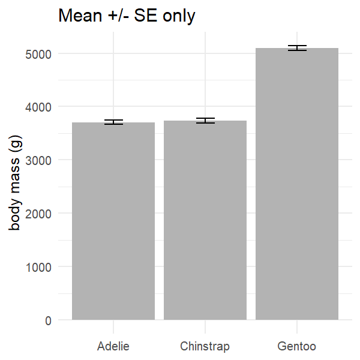
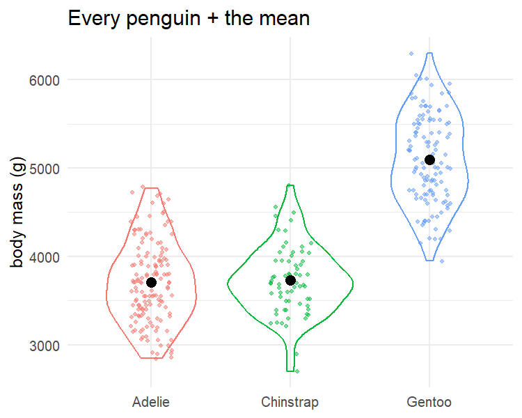
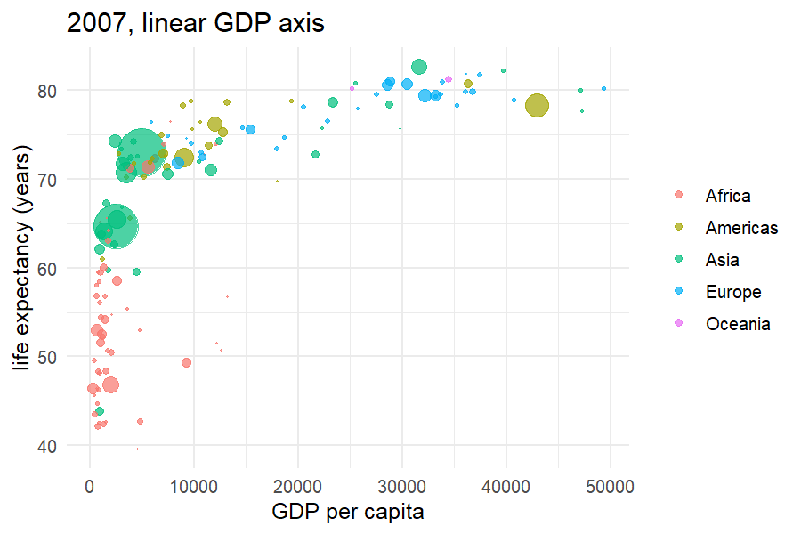
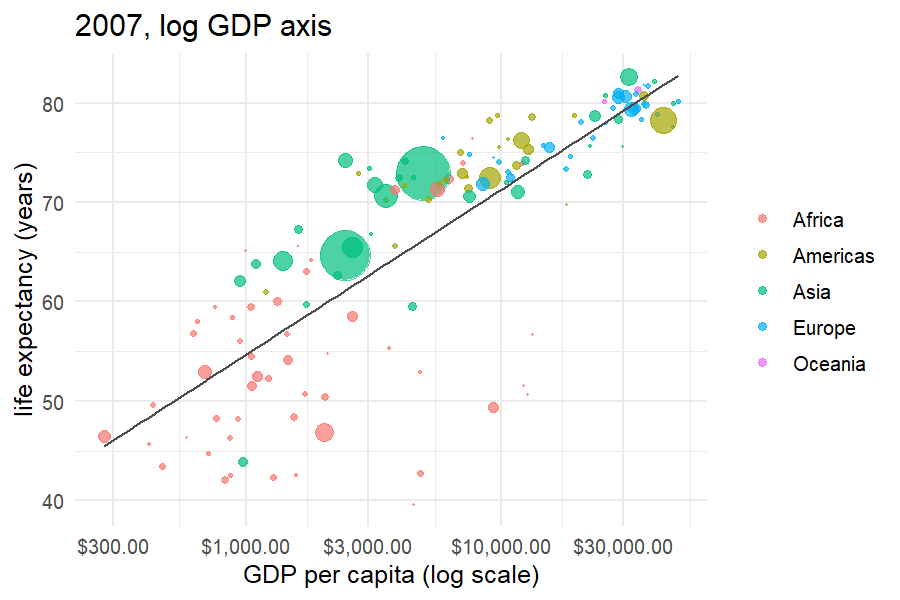
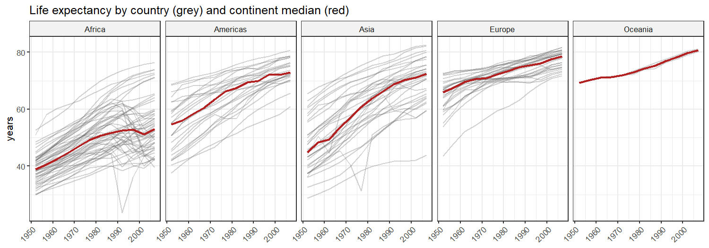
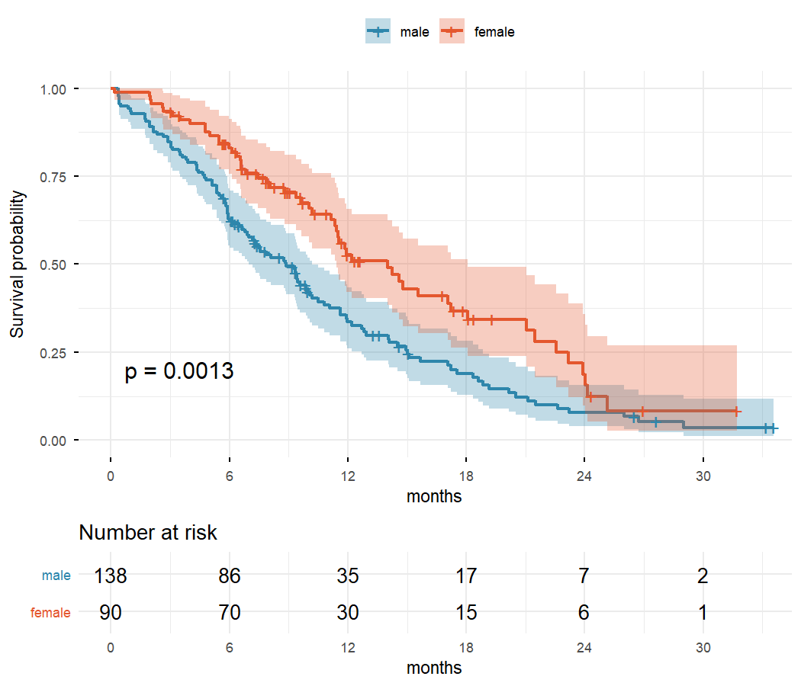
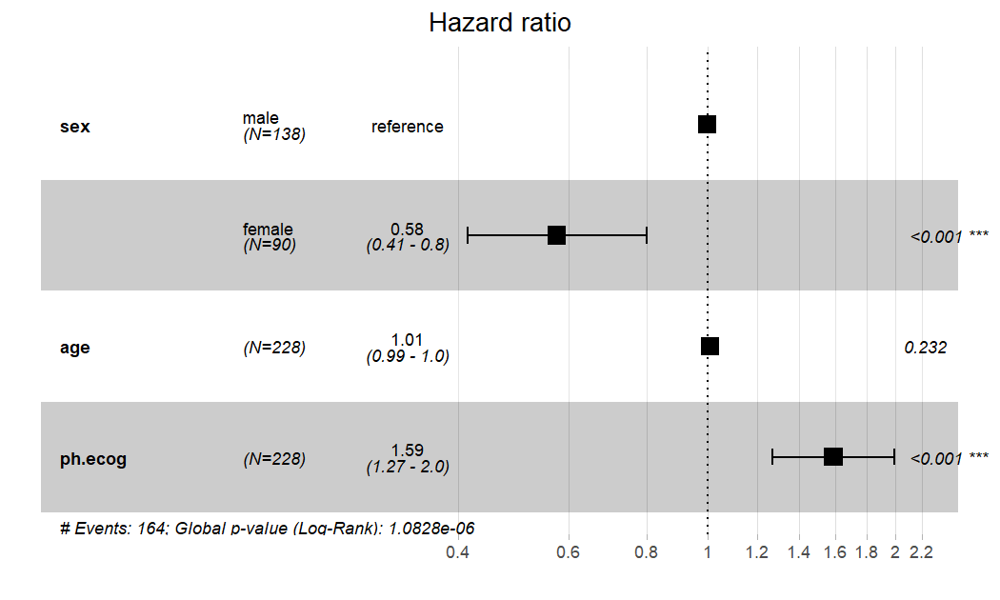
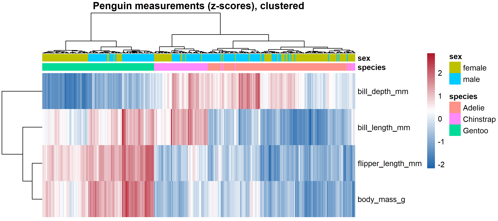

# data-visualization-in-r

My own practice code for the topics of the McGill MiCM workshop [Data Visualization in R](https://github.com/QLS-MiCM/Fall-2026-Bootcamp-Data-Visualization-in-R) (October 2026): ggplot2 basics, scales and faceting, themes and colour, heatmaps, survival curves, plotly and Shiny. The code here is written from scratch on public datasets.

## Run

```r
# from the repo root, regenerates everything in figures/ and output/
source("run_all.R")

# interactive app
shiny::runApp("app")
```

Built with R 4.6.1. `run_all.R` installs any missing packages.

| Script | Data | Topics |
|---|---|---|
| `R/01_basics.R` | Palmer penguins | bar, histogram + density, box, violin + jitter |
| `R/02_scales_facets_themes.R` | gapminder | log scale, facets, custom theme, colour palettes, ridgelines |
| `R/03_specialized.R` | `survival::lung`, penguins | Kaplan-Meier, Cox forest plot, clustered heatmap |
| `R/04_interactive.R` | gapminder | animated plotly chart (`output/gapminder_animated.html`) |
| `app/app.R` | gapminder | Shiny app with continent and year filters |

## Some of the figures

**Showing the data, not just the mean.** The same body-mass comparison as a bar with error bars, then as every penguin plus the mean:

<p>
  
  
</p>

**Log scale.** GDP per capita spans two orders of magnitude, so on a linear axis most countries are squeezed to the left:

<p>
  
  
</p>

**Facets.** One panel per continent, each country in grey and the continent median in red:



**Survival analysis.** NCCTG lung cancer trial (`survival::lung`, 228 patients). Median survival is 270 days for men and 426 for women (log-rank p = 0.001). In a Cox model adjusted for age and ECOG performance score, the hazard ratio for women is 0.58 (95% CI 0.41 to 0.80), and each extra ECOG point raises the hazard by about 1.6 times.

<p>
  
  
</p>

**Heatmap.** Penguin measurements as z-scores, clustered. Gentoo separates on its own, mostly through bill depth, flipper length and body mass:



All other figures are in [figures/](figures).
